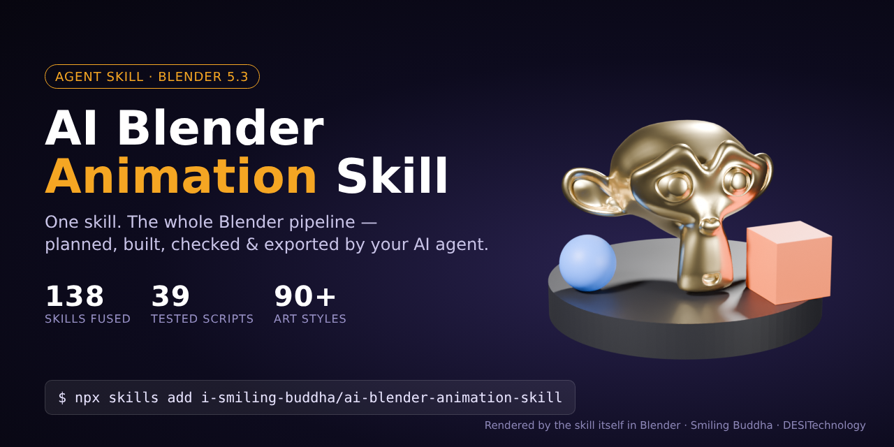

# AI Blender Animation Skill — हिंदी गाइड



> English: [README.md](README.md)

**One Skill. The Whole Blender Pipeline.**

> अपने agent को बताइए कि Blender में क्या चाहिए — वो technical art director की तरह plan करता है, फिर बनाता है, check करता है और export करता है।

AI Blender Animation Skill तीन open Blender skill packs (**138 skills**) को fuse करके **एक** agent skill बनाता है। एक router आपकी request समझता है, सिर्फ ज़रूरी guide खोलता है, tested `bpy` scripts को आपके open Blender में (blender-mcp से) या headless चलाता है, और "done" बोलने से पहले result verify करता है।

## सबसे आसान install (कोई भी agent, 10 seconds)

```bash
npx skills add i-smiling-buddha/ai-blender-animation-skill
```

## Features

- **Director workflow** — हर asset के लिए Analyze → Plan → Brief → Execute → Validate → Deliver, platform के हिसाब से poly/texture budgets, और reference image match loop।
- **23 domain guides** — modeling, sculpting, retopo/UV, PBR + baking, Geometry Nodes, environments, rigging + animation, simulation/VFX/weather, lighting, rendering, LODs, engine export, QA, video editing।
- **90+ art styles** — anime, low-poly, PSX horror, voxel, HD-2D, toon/NPR, noir, cozy, cyberpunk, और RPG / soulslike / shooter / survival जैसे genres की art direction।
- **39 tested Python scripts** — QA check, auto retopo, UV pack, PBR builder, bake maps, Rigify build, mocap retarget, LODs, terrain, scatter, rain/snow/lightning, render batch, engine presets के साथ export।
- **Product video kit** — turntable, slow zoom, dolly, crane, speed-ramp loop, perfect loop, Poly Haven studios, Three.js web viewer export।
- **Photo → 3D** — फ़ोटो से textured model (Meshy API), फिर retopo और QA।
- **Blender 5.x safe** — 5.x के API changes के rules पहले से अंदर हैं, जो पुराने tutorials और LLM memory को तोड़ देते हैं।
- **Live या headless** — blender-mcp से आपका open Blender चलाता है, या बिना MCP के background में Blender run करता है।

## Real Blender में tested

हर Python script असली **Blender 5.3** (`pip install bpy==5.3.0`) में test होता है: `python tests/smoke_test.py`। Test के दौरान दो bugs मिले और fix हुए: एक, object का नाम list की जगह string देने पर script उसे अलग-अलग अक्षरों में तोड़ देता था; दो, `build_pbr_material` बिना preset के `color` को ignore कर देता था। हर push पर GitHub Actions यही test चलाता है। ऊपर वाला banner भी इसी skill के scripts से Blender में render हुआ है: [examples/render_banner.py](examples/render_banner.py)।

## Repo से install

**Windows:** repo clone कीजिए, फिर `scripts\install.bat` पर double-click — skill `%USERPROFILE%\.claude\skills\ai-blender-animation-skill` में install हो जाएगी।

**macOS / Linux:**

```bash
git clone https://github.com/i-smiling-buddha/ai-blender-animation-skill
sh ai-blender-animation-skill/scripts/install.sh
```

**ज़रूरी:** Blender 5.2 LTS या नया (5.3 best)। Optional: live session के लिए [blender-mcp](https://github.com/ahujasid/blender-mcp) (`claude mcp add blender -- uvx blender-mcp`), `scripts/node` के लिए Node.js, और photo → 3D के लिए `MESHY_API_KEY`।

## Quick start

Blender खोलिए, blender-mcp add-on connect कीजिए, फिर बस बोलिए:

- "Mobile budget वाला game-ready sci-fi crate बनाओ, Unity में export करो"
- "इस character को Rigify से rig करो और मेरा Mixamo run retarget करो"
- "इस product का Poly Haven studio HDRI पर turntable video बनाओ"
- "Fog और flickering lights वाला PSX horror corridor"

## Honest limitations

- **Structural merge** — overlapping skills हर topic की एक guide में grouped हैं, लेकिन हर source का text जैसा था वैसा रखा है, दोबारा नहीं लिखा। दो sources में conflict हो तो SKILL.md के Blender 5.x rules मान्य हैं।
- **Scripts Blender 5.2+ के लिए हैं** — पुराने versions में API errors आएँगे।
- **`guides/23-websocket-toolkit.md`** को external Dev-GOM blender-toolkit add-on चाहिए, जो bundled नहीं है।
- **Photo → 3D** paid Meshy API use करता है।

## Credits

[arjun988/blender-skills](https://github.com/arjun988/blender-skills) (MIT), [el4cteo/blender-skills](https://github.com/el4cteo/blender-skills) (MIT) और [kevinbadi/blender-skills](https://github.com/kevinbadi/blender-skills) पर आधारित। Details: [THIRD_PARTY_NOTICES.md](THIRD_PARTY_NOTICES.md)।

## Smiling Buddha की और free skills

- **[AI Video Vision Skill](https://github.com/i-smiling-buddha/ai-video-vision-skill)** — अपने agent को video देखने-सुनने की ताक़त दीजिए: YouTube, TikTok, X, Instagram या local video देखकर timestamps के साथ जवाब देता है — captions, free local Whisper, smart scene frames और optional Gemini engine के साथ। `npx skills add i-smiling-buddha/ai-video-vision-skill`
- **[Smart Model Router Skill](https://github.com/i-smiling-buddha/smart-model-router-skill)** — हर task के लिए सही model: आपका agent सबसे सस्ता काम करने लायक model चुनता है, result verify करता है और fail होने पर ही escalate करता है। `npx skills add i-smiling-buddha/smart-model-router-skill`
- **[AI Image Recognition Skill](https://github.com/i-smiling-buddha/ai-image-recognition-skill)** — असली image file में transparency, format, size/DPI, colors, blur और GPS metadata check करता है। `npx skills add i-smiling-buddha/ai-image-recognition-skill`
- **[Reflection Skill](https://github.com/i-smiling-buddha/reflection-skill)** — किसी भी app, website, game या software का clean-room तरीके से अपने brand के साथ बेहतर version। `npx skills add i-smiling-buddha/reflection-skill`
- **[PPT Animation Skill](https://github.com/i-smiling-buddha/ppt-animation-skill)** — किसी भी topic से Kurzgesagt-style animated explainer video, offline Hindi/English voiceover के साथ। `npx skills add i-smiling-buddha/ppt-animation-skill`
- **[Countdown Video Skill](https://github.com/i-smiling-buddha/countdown-video-skill)** — animated cards, trailer clips, music और YouTube chapters के साथ Top-N countdown videos। `npx skills add i-smiling-buddha/countdown-video-skill`

## Contributing

Issues, bug reports और pull requests का स्वागत है — खासकर Blender-version fixes और नए scripts। कृपया public issues में API keys न डालें।

## License

MIT. Made by [Smiling Buddha](https://github.com/i-smiling-buddha) · [DESITechnology](https://desitechnology.com).
