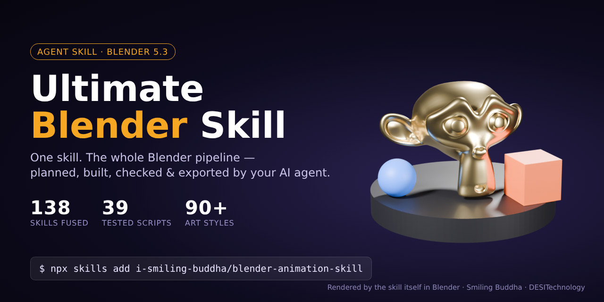

# Ultimate Blender Skill



**One skill. The whole Blender pipeline.**

[](https://github.com/i-smiling-buddha/blender-animation-skill/actions/workflows/ci.yml)


[](https://github.com/i-smiling-buddha/blender-animation-skill/stargazers)

> Tell your agent what you want in Blender. It plans the asset like a technical art director, then builds, checks and exports it.

Ultimate Blender combines three open Blender skill packs (**138 skills**) into **one** agent skill. One router reads your request, opens only the guide it needs, runs tested `bpy` scripts in your open Blender (through blender-mcp) or headless, and checks the result before it says "done".

हिंदी गाइड: **[README.hi.md](README.hi.md)**

**Try it in 10 seconds.** Works in Claude Code, Codex, Cursor, OpenCode and 40+ agents:

```bash
npx skills add i-smiling-buddha/blender-animation-skill
```

## Features

- **Director workflow**: every asset follows Analyze → Plan → Brief → Execute → Validate → Deliver, with poly/texture budgets per platform and a reference-image match loop.
- **23 domain guides**: modeling, sculpting, retopo/UV, PBR + baking, Geometry Nodes, environments, rigging + animation, simulation/VFX/weather, lighting, rendering, LODs, engine export, QA, video editing, and more.
- **90+ art styles**: anime, low-poly, PSX horror, voxel, HD-2D, toon/NPR, noir, cozy, cyberpunk, and genre direction for RPG, soulslike, shooter, survival and others.
- **39 Python scripts tested in real Blender 5.3**: QA check, auto retopo, UV pack, PBR builder, bake maps, Rigify build, mocap retarget, LODs, terrain, scatter, rain/snow/lightning, render batch, export with engine presets, all sharing one helper module.
- **Product video kit**: turntable, slow zoom, dolly, crane, speed-ramp loop, perfect loop, Poly Haven studios, Three.js web viewer export.
- **Photo → 3D**: one or more photos become a textured model (Meshy API), then get retopo and QA.
- **Blender 5.x safe**: built-in rules for the 5.x API changes that break old tutorials and LLM memory.
- **Live or headless**: drives your open Blender through blender-mcp, or runs Blender in the background with no MCP at all.

## Tested in real Blender

Every Python script runs against real **Blender 5.3** (`pip install bpy==5.3.0`): `python tests/smoke_test.py`. Testing caught and fixed two bugs: scripts split an object name passed as a plain string (instead of a list) into single letters, and `build_pbr_material` ignored `color` when no preset was given. GitHub Actions runs the same test on every push. The banner above was rendered in Blender by this skill's own scripts: [examples/render_banner.py](examples/render_banner.py).

## Install

### Option 1: one command (any agent)

```bash
npx skills add i-smiling-buddha/blender-animation-skill
```

### Option 2: from the repo

**Windows:** clone, then double-click `scripts\install.bat` (installs to `%USERPROFILE%\.claude\skills\ultimate-blender`).

**macOS / Linux:**

```bash
git clone https://github.com/i-smiling-buddha/blender-animation-skill
sh blender-animation-skill/scripts/install.sh
```

**Requirements:** Blender 5.2 LTS or newer (5.3 recommended). Optional: [blender-mcp](https://github.com/ahujasid/blender-mcp) for live sessions (`claude mcp add blender -- uvx blender-mcp`), Node.js for `scripts/node`, and `MESHY_API_KEY` for photo → 3D.

## Quick start

Open Blender, connect the blender-mcp add-on, then just ask:

- "Make a game-ready sci-fi crate, mobile budget, export to Unity"
- "Rig this character with Rigify and retarget my Mixamo run"
- "Turntable video of this product on a Poly Haven studio HDRI"
- "PSX horror corridor with fog and flickering lights"

## How it's organized

```text
skills/ultimate-blender/
├── SKILL.md      router: director workflow, 5.x rules, task → guide table, verify gate
├── guides/       23 fused domain guides (each section labelled with its source pack)
├── styles/       art styles, horror, worlds & moods, game genres
├── scripts/      39 bpy scripts + run_in_blender.py (headless) + node/ helpers
├── refs/         deep-dive references (budgets, API changes, recipes, checklists)
└── assets/       Blender extension (add-on) template
```

## Honest limitations

- **Structural merge.** Overlapping skills are grouped into one guide per topic, but each source's text is kept as written, not rewritten. When two sources disagree, SKILL.md's Blender 5.x rules win.
- **Scripts target Blender 5.2+.** Older versions will hit API errors.
- **`guides/23-websocket-toolkit.md`** needs the external Dev-GOM blender-toolkit add-on, which is not bundled.
- **Photo → 3D** uses the paid Meshy API.

## Credits

Built on [arjun988/blender-skills](https://github.com/arjun988/blender-skills) (MIT), [el4cteo/blender-skills](https://github.com/el4cteo/blender-skills) (MIT) and [kevinbadi/blender-skills](https://github.com/kevinbadi/blender-skills). See [THIRD_PARTY_NOTICES.md](THIRD_PARTY_NOTICES.md).

## More free skills by Smiling Buddha

- **[Smart Model Router Skill](https://github.com/i-smiling-buddha/smart-model-router-skill)**: one task, right model. Your agent routes each task to the cheapest model that can do it, verifies the result and escalates only on failure. `npx skills add i-smiling-buddha/smart-model-router-skill`
- **[AI Image Recognition Skill](https://github.com/i-smiling-buddha/ai-image-recognition-skill)**: stop guessing from previews. Your agent checks real transparency, true format, size/DPI, colors, blur and GPS metadata in the actual image file. `npx skills add i-smiling-buddha/ai-image-recognition-skill`
- **[Reflection Skill](https://github.com/i-smiling-buddha/reflection-skill)**: recreate any app, website, game or software, clean-room, under your own brand. `npx skills add i-smiling-buddha/reflection-skill`
- **[PPT Animation Skill](https://github.com/i-smiling-buddha/ppt-animation-skill)**: turn any topic into a Kurzgesagt-style animated explainer video with offline Hindi/English voiceover. `npx skills add i-smiling-buddha/ppt-animation-skill`
- **[Countdown Video Skill](https://github.com/i-smiling-buddha/countdown-video-skill)**: rank anything and count it down with animated cards, trailer clips, music and YouTube chapters. `npx skills add i-smiling-buddha/countdown-video-skill`

## Contributing

Issues, bug reports and pull requests are welcome, especially Blender-version fixes and new scripts. Please don't paste API keys in public issues.

## License

MIT. Made by [Smiling Buddha](https://github.com/i-smiling-buddha) · [DESITechnology](https://desitechnology.com).
